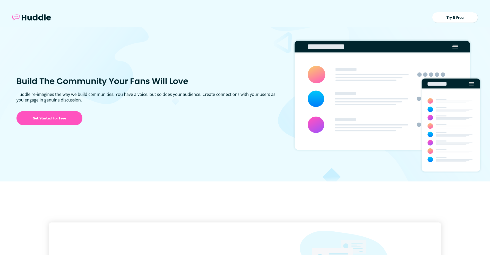

# Huddle landing page

This project is based on a Frontend Mentor challenge

---

## Screenshot
  

---

## Live Demo

- Live Site: [Live site URL](https://devnielote.github.io/huddle-landing/)
- Solution: [Solution URL](https://www.frontendmentor.io/solutions/responsive-static-landing-page-usign-html5-and-css-BppkGLDqjr)

## Project Purpose 

I built this project with the goal of practicing:

- Scalable CSS using `@layer` and custom properties
- Responsive layouts with media queries and flexbox
- Creating modular, reusable UI components with pure CSS
- Clean visual hierachy and accesiblity principles

---

## Built with

- Semantic HTML5 markup
- CSS custom properties
- Flexbox
- Mobile-first workflow

## Author

- Frontend Mentor - [@Devnielote](https://www.frontendmentor.io/profile/Devnielote)

